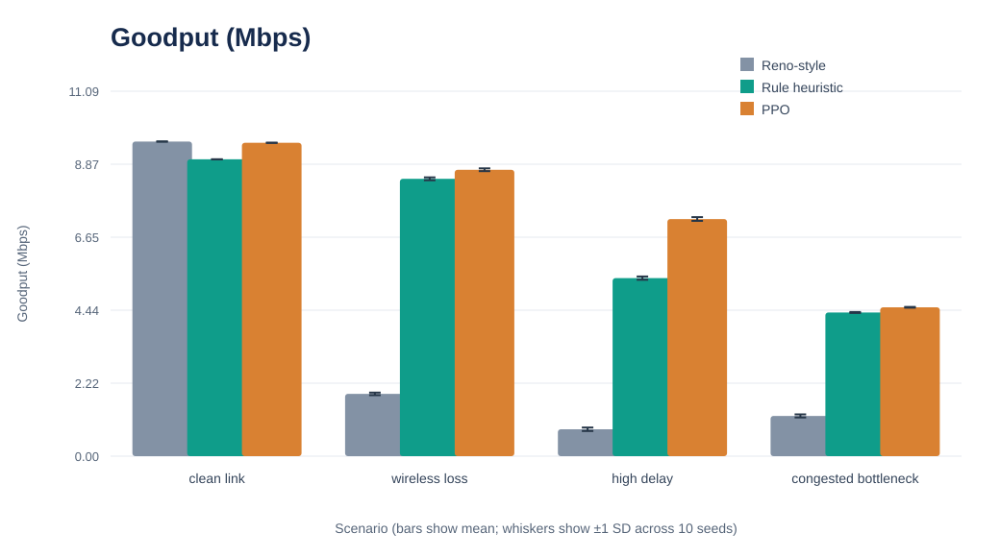
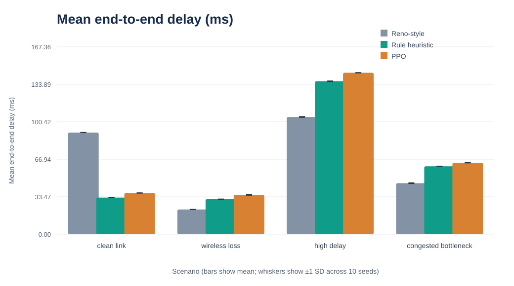
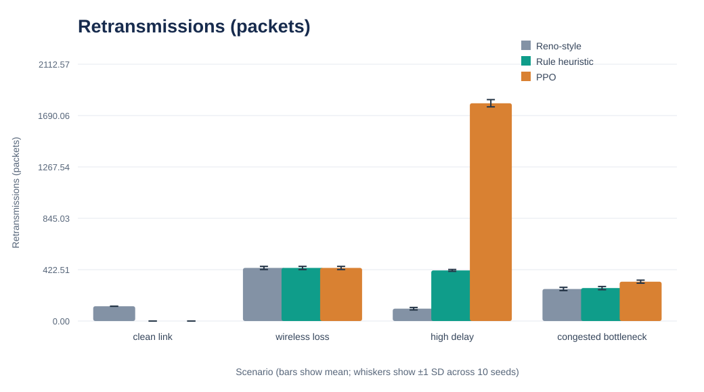
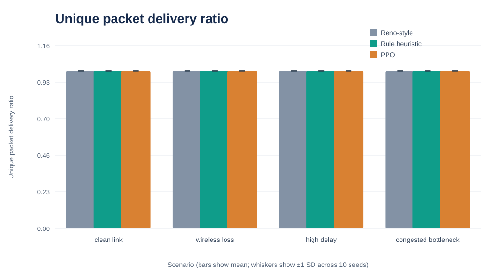

# AI-Driven Adaptive Reliable Transmission for Lossy Networks

[](https://www.python.org/)
[-success.svg)](requirements.txt)
[](scripts/verify_project.py)
[](LICENSE)

An experimental transmission framework and discrete-event packet simulation comparing **Reno-style AIMD**, **rule-based heuristics**, and a **custom clipped PPO (Proximal Policy Optimization) actor-critic** across lossy, delayed, and congested network topologies.

Developed using **pure Python standard library**—zero external dependencies (no PyTorch, Stable-Baselines3, or Gymnasium required).

---

## Table of Contents

- [Overview](#overview)
- [Architecture & Design](#architecture--design)
- [Controller Comparison](#controller-comparison)
- [Experimental Scenarios](#experimental-scenarios)
- [Benchmark Results](#benchmark-results)
- [Visualizations](#visualizations)
- [Repository Structure](#repository-structure)
- [Getting Started](#getting-started)
- [Documentation & Reports](#documentation--reports)
- [References](#references)
- [License](#license)

---

## Overview

Traditional transport mechanisms (such as TCP Reno) interpret packet loss as an indicator of network congestion, halving the transmission window. On wireless links or lossy paths, non-congestive packet drops trigger premature backoffs, resulting in degraded goodput.

This project implements:
1. **Discrete-Event Network Simulator**: A discrete-time single-bottleneck FIFO queue simulator with configurable propagation delay, packet loss rates, and service capacity.
2. **Three Sender Controllers**:
   - **Reno-Style Baseline**: Additive increase (+1 packet/RTT) and multiplicative decrease (0.5× on loss).
   - **Rule-Based Heuristic**: Differentiates between random loss and queue inflation via smoothed telemetry.
   - **Custom PPO Actor-Critic**: A compact neural network mapping loss, delay inflation, and queue occupancy to continuous rate adjustments.
3. **Rigorous Experimental Evaluation**: 120 training episodes followed by 120 held-out evaluation runs (10 seeds × 4 scenarios × 3 modes) evaluating Goodput, Delivery Ratio, Mean Delay, and Retransmissions.

---

## Architecture & Design

```
+------------------------------------------------------------------------+
|                            Sender Node                                 |
|                                                                        |
|  [ Observation Telemetry ] ---> [ PPO Actor-Critic / Heuristic / Reno] |
|   - Packet loss rate                                |                  |
|   - Delay inflation (RTT)                           v                  |
|   - Queue occupancy ratio            [ Window & Pacing Multipliers ]   |
+------------------------------------------------------------------------+
                                     |
                                     v Offered Packets
+------------------------------------------------------------------------+
|                          Bottleneck Link                               |
|                                                                        |
|   +-----------------------+              +------------------------+    |
|   |   Finite FIFO Queue   |  -- Service -->  Random Loss Channel  |    |
|   | (Buffer Overflow Drop)|              |   (Wireless Loss Rate) |    |
|   +-----------------------+              +------------------------+    |
+------------------------------------------------------------------------+
                                     |
                                     v Delivered Packets
+------------------------------------------------------------------------+
|                            Receiver Node                               |
|                     (Delay & Delivery Telemetry)                       |
+------------------------------------------------------------------------+
```

---

## Controller Comparison

| Controller | Algorithm Type | State Inputs | Action Space | Key Mechanism |
|---|---|---|---|---|
| **Reno-style** | Static AIMD | Binary loss detection | Multiplicative / Additive | Window halved on loss, +1 packet/RTT on clean interval |
| **Rule Heuristic** | Hand-crafted adaptive | Loss rate, delay, queue | Continuous multipliers | Differentiates congestion loss from wireless corruption |
| **PPO Policy** | On-policy RL Actor-Critic | Loss, delay inflation, queue | Categorical (0.93×, 1.00×, 1.07×) | Maximizes clipped surrogate reward with GAE value estimation |

### Custom PPO Implementation Details
- **Architecture**: 12-unit `tanh` hidden layer for both actor and critic networks.
- **Optimization**: Clipped surrogate loss ($\epsilon = 0.20$), Generalized Advantage Estimation ($\lambda = 0.92, \gamma = 0.97$), Adam optimizer.
- **Reward Function**: Rewards link utilization while penalizing queue buildup, loss, and delay inflation:
  $$r = \frac{\text{delivered}}{\text{service}} - 0.35 \times \text{queue} - 1.20 \times \text{loss} - 0.20 \times \min(1, \text{delay\_inflation}/2)$$

---

## Experimental Scenarios

Each experiment evaluates transmission of **5,000 unique 1,200-byte packets** across 10 random seeds per scenario:

| Scenario | Random Link Loss | Baseline RTT | Service Capacity | FIFO Capacity |
|---|---:|---:|---:|---:|
| **Clean Link** | 0% | 20 ms | 1,000 pkts/s | 100 packets |
| **Wireless Loss** | 8% | 20 ms | 1,000 pkts/s | 100 packets |
| **High Delay** | 2% | 100 ms | 1,000 pkts/s | 100 packets |
| **Congested Bottleneck** | 5% | 40 ms | 500 pkts/s | 24 packets |

---

## Benchmark Results

Summary statistics across 120 held-out evaluation runs (Mean ± 1 Standard Deviation):

| Scenario | Controller | Goodput (Mbps) $\uparrow$ | Delivery Ratio $\uparrow$ | Mean Delay (ms) $\downarrow$ | Retransmissions $\downarrow$ |
|---|---|---:|---:|---:|---:|
| **Clean Link** | Reno-style | 9.562 ± 0.000 | 1.000 | 90.809 ± 0.000 | 122.0 ± 0.0 |
| | Rule Heuristic | 9.023 ± 0.000 | 1.000 | 32.743 ± 0.000 | 0.0 ± 0.0 |
| | **PPO Policy** | **9.524 ± 0.000** | **1.000** | **36.841 ± 0.000** | **0.0 ± 0.0** |
| **Wireless Loss** | Reno-style | 1.893 ± 0.039 | 1.000 | 22.100 ± 0.058 | 436.7 ± 13.1 |
| | Rule Heuristic | 8.430 ± 0.045 | 1.000 | 31.313 ± 0.071 | 436.7 ± 13.1 |
| | **PPO Policy** | **8.705 ± 0.042** | **1.000** | **35.131 ± 0.238** | **436.7 ± 13.1** |
| **High Delay** | Reno-style | 0.817 ± 0.052 | 1.000 | 104.743 ± 0.289 | 101.6 ± 10.2 |
| | Rule Heuristic | 5.412 ± 0.050 | 1.000 | 136.606 ± 0.213 | 416.6 ± 7.4 |
| | **PPO Policy** | **7.208 ± 0.056** | **1.000** | **144.230 ± 0.047** | **1791.5 ± 29.7** |
| **Congested Bottleneck** | Reno-style | 1.223 ± 0.046 | 1.000 | 45.581 ± 0.288 | 263.7 ± 13.7 |
| | Rule Heuristic | 4.367 ± 0.015 | 1.000 | 60.689 ± 0.065 | 271.1 ± 12.9 |
| | **PPO Policy** | **4.523 ± 0.012** | **1.000** | **63.796 ± 0.082** | **323.8 ± 12.3** |

### Key Findings
- **Goodput Gains**: PPO achieved higher goodput than the heuristic in all 4 scenarios (+5.6% on clean link, +3.3% in wireless loss, +33.2% under high delay, +3.6% under congestion).
- **Latency Trade-off**: PPO's aggressive utilization resulted in slightly higher average queuing delay (+5.1% to +12.5%).
- **Retransmission Cost**: Under high propagation delay, PPO sustained high goodput at the expense of higher retransmissions (+330.1% vs. heuristic).

---

## Visualizations

### Goodput (Mbps)


### Mean End-to-End Delay (ms)


### Retransmission Overhead


### Packet Delivery Ratio


---

## Repository Structure

```
.
├── .gitignore                     # Git ignore rules for Python & IDEs
├── LICENSE                        # MIT License
├── README.md                      # Comprehensive project documentation
├── requirements.txt               # Dependencies declaration (Standard Library only)
├── verify_project.py              # Root convenience test runner
├── run_experiments.py             # Root convenience experiment runner
│
├── src/                           # Core source modules
│   ├── __init__.py                # Package initialization
│   ├── adaptive_controller.py     # Rule-based heuristic sender baseline
│   ├── network_simulator.py       # Discrete-time FIFO network simulator
│   ├── ppo_controller.py          # Dependency-free clipped PPO actor-critic
│   └── train_ppo_policy.py        # PPO training loop & policy exporter
│
├── scripts/                       # Execution and verification scripts
│   ├── __init__.py                # Scripts package initialization
│   ├── verify_project.py          # Fast validation test suite
│   └── run_experiments.py         # Full benchmarking pipeline & SVG plotter
│
├── results/                       # Generated data & benchmark results
│   ├── ppo_policy.json            # Frozen trained neural network weights
│   ├── training_history.csv       # 120-episode PPO training trace
│   ├── replicate_results.csv      # Raw per-seed evaluation outcomes
│   └── summary_results.csv        # Aggregated benchmark metrics
│
├── figures/                       # Evaluation charts & SVG diagrams
│   ├── throughput_mbps.svg        # Goodput bar chart with error whiskers
│   ├── average_delay_ms.svg       # End-to-end delay comparison
│   ├── retransmissions.svg        # Retransmission volume comparison
│   ├── packet_delivery_ratio.svg  # Delivery ratio verification
│   └── Graph.png                  # Supplementary summary diagram
│
└── docs/                          # In-depth case study documentation
    ├── study_report.md            # Complete academic case study report
    ├── PERSON1_METHODOLOGY.md     # PPO implementation & algorithmic analysis
    ├── case_study_CN_final.docx   # Final submission document (Word)
    └── team_presentation.pptx     # Presentation slide deck (PowerPoint)
```

---

## Getting Started

### Prerequisites
- Python 3.8 or higher.
- No third-party packages required (uses standard library modules: `random`, `math`, `csv`, `pathlib`, `dataclasses`, `json`, `statistics`).

### Verification & Fast Check
Run unit validation for bounds, directional behavior, and simulation repeatability:
```bash
python verify_project.py
```
*(Alternatively: `python scripts/verify_project.py`)*

### Run Complete Benchmarking Pipeline
Train PPO for 120 episodes, evaluate 120 held-out test runs, and regenerate all CSVs and SVG figures:
```bash
python run_experiments.py
```
*(Alternatively: `python scripts/run_experiments.py`)*

### Run Standalone Simulation
Execute a direct simulation run using the saved policy:
```bash
python src/network_simulator.py
```

---

## Documentation & Reports

Detailed documentation is available in the [`docs/`](docs/) directory:
- [Academic Study Report](docs/study_report.md): In-depth methodology, literature review, and analysis.
- [Algorithm & Training Methodology](docs/PERSON1_METHODOLOGY.md): Comprehensive derivation of the PPO actor-critic.
- Final Word Report: [`docs/case_study_CN_final.docx`](docs/case_study_CN_final.docx)
- Team Presentation Slides: [`docs/team_presentation.pptx`](docs/team_presentation.pptx)

---

## References

1. “DNCCQ-PPO: A dynamic network congestion control algorithm based on deep reinforcement learning for XQUIC,” *Journal of Network and Computer Applications*, vol. 245, Art. 104371, 2026. [DOI](https://doi.org/10.1016/j.jnca.2025.104371)
2. H. Ma, D. Xu, and X. Wang, “Congestion control algorithm-aware queue management,” *Computer Networks*, vol. 276, Art. 111975, 2026. [DOI](https://doi.org/10.1016/j.comnet.2025.111975)
3. J. Zhang, J. Zhou, and J. Yuan, “Active queue management based on fuzzy logic and reinforcement learning,” *Computer Networks*, vol. 282, Art. 112272, 2026. [DOI](https://doi.org/10.1016/j.comnet.2026.112272)
4. S. K. Pattiwar, P. Saxena, and Ö. Alay, “PRISM: Proximal policy optimization with deep Reinforcement learning for Intelligent Scheduling in Multipath QUIC under heterogeneous and hybrid 5G/B5G-satellite networks,” *Computer Communications*, vol. 252, Art. 108523, 2026. [DOI](https://doi.org/10.1016/j.comcom.2026.108523)
5. M. Luglio, C. Roseti, D. Verde, and F. Zampognaro, “QUIC Wave: Bringing bursts at application level to efficiently face new communication scenarios,” *Computer Networks*, vol. 281, Art. 112185, 2026. [DOI](https://doi.org/10.1016/j.comnet.2026.112185)

---

## License

This project is licensed under the [MIT License](LICENSE).
